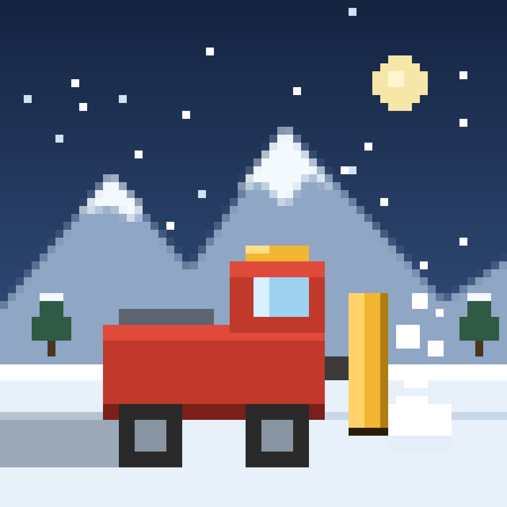
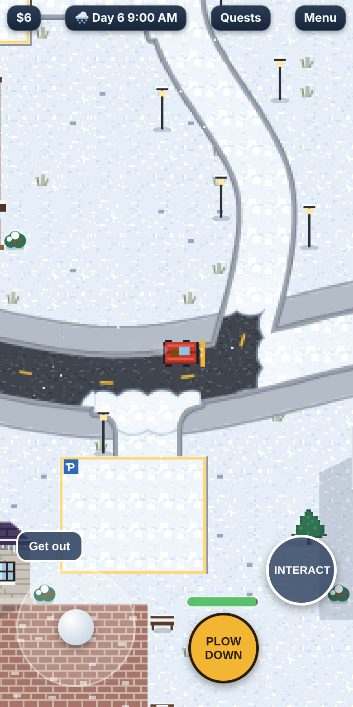
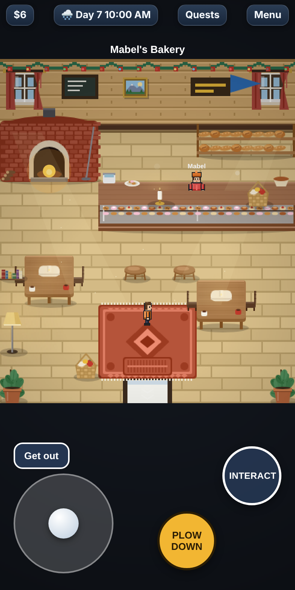
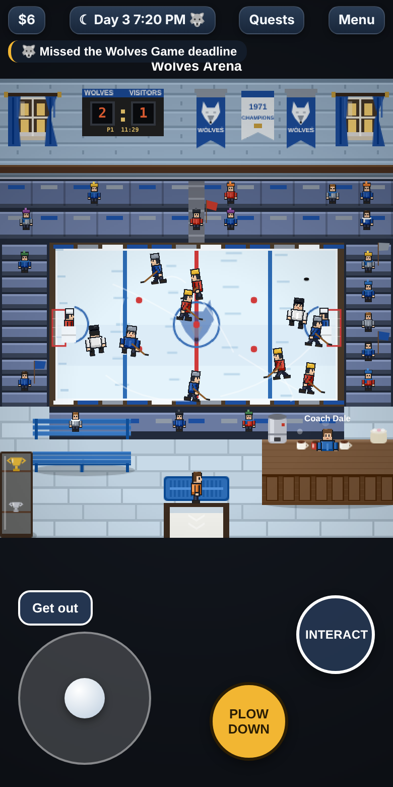
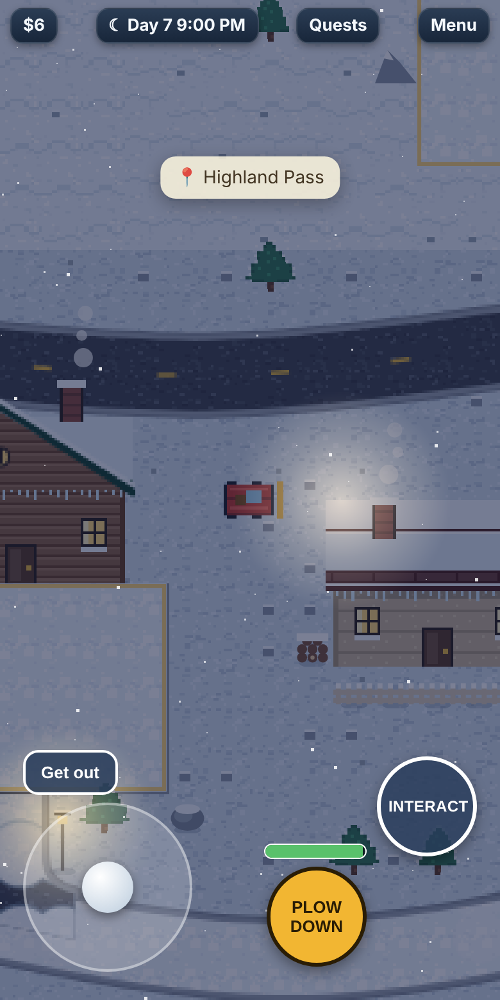
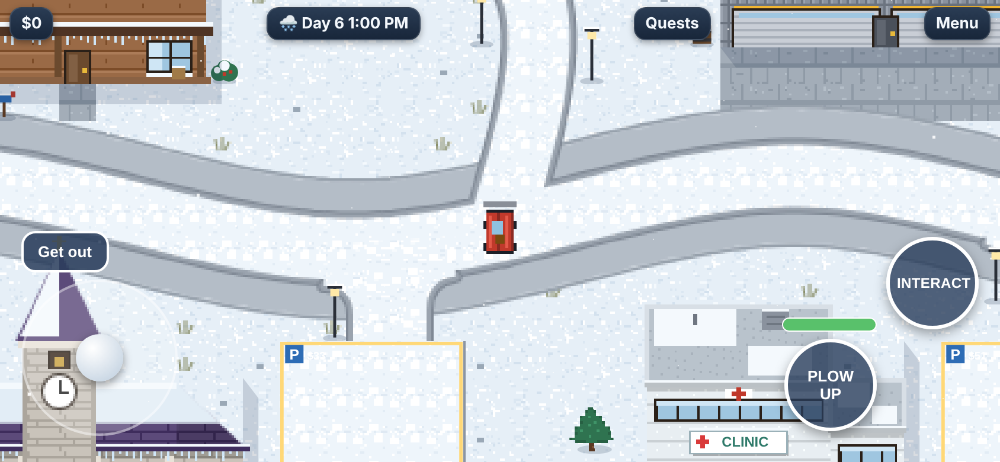

<p align="center">
  
</p>

<h1 align="center">Frostvale</h1>
<p align="center"><b>A Snow Plow Life</b><br>A cozy mountain-town life sim for phones. Plow the roads, make friends and bring a snowed-in valley back to life.</p>

<p align="center">
  
  
  
  
</p>

## Play

**▶ [Play in your browser](https://YOUR-USERNAME.github.io/frostvale/)** (works best on a phone, in portrait or landscape)

The whole game is a single file, [`www/index.html`](www/index.html), with no build step and no dependencies. You can also open it straight from your computer.

## About the game

You're Frostvale's new snow plow driver. Each morning the valley wakes up buried, and it's your job to dig it out.

- **Plow and earn.** Clear roads and parking lots for pay, then upgrade from a town truck to the Summit Plow so you can climb higher up the mountain.
- **Neighbours.** Each of the 14 townsfolk has a daily routine, favourite gifts, quests, and heart events you keep as snow globe memories.
- **Town life.**
  - Hockey nights for the Frostvale Wolves.
  - Emergency dispatch calls.
  - Daily weather with a radio forecast.
  - Mail every morning.
  - Shop owners standing at their counters.
- **Seasons and festivals.** Each year has four winter seasons (First Snow, Deep Winter, Long Nights and The Thaw), each with its own festival: the Lantern Walk, the Winter Fair, the Plow Parade and the Spring Melt Potluck.
- **Collecting.**
  - Ice fishing on Mirror Lake and Frost Creek.
  - Relics dug up from the snow for the Frostvale Archive.
- **Long-term goals.**
  - Restore and reopen Frostpine Ski Hill.
  - Three story questlines: The Frost Lights, The Lost Mail of '58 and Big Bertha.
- **Make it yours.** Customise your character, and give your truck a new paint job, plow blade, light bar and Wolves flag.

<p align="center"></p>

### Controls

| | |
|---|---|
| Drive or walk | Drag the joystick |
| Raise or lower the plow | **PLOW** button |
| Talk, shop, enter doors, fish | **INTERACT** button |
| Leave or get back in the truck | **Get out** / **Get in** |
| Goals and events | **Quests** |
| Items, map, friends, journal, save | **Menu** |

On a keyboard, WASD or the arrow keys move, E interacts and Space raises or lowers the plow.

New games start with a short tutorial that you can skip. It can be replayed from Menu → Save.

## Project layout

```
www/index.html         The complete game (HTML, CSS and JavaScript in one file)
www/privacy.html       Privacy policy page (served by GitHub Pages)
assets/                App icon and splash screen source art
media/                 Screenshots for this README
tests/smoke.test.js    Headless test of core systems (no dependencies)
docs/BUILD-APP.md      Building and publishing the iOS and Android apps
capacitor.config.json  Native app settings (app name, ID, splash)
package.json           Capacitor dependencies and scripts
.github/workflows/     Automatic GitHub Pages deploy and test runs
```

## Development

Edit `www/index.html` and refresh your browser. To check that nothing broke:

```bash
node tests/smoke.test.js
```

The smoke test runs the game in Node with a stubbed browser. It checks plowing and pay, every parking lot, a full day of NPC and car movement, entering and leaving buildings, rendering by day and night, the mail schedule, and save/load. It also runs automatically on every push.

Saves are stored in the browser's local storage under `pp_save_v1`. On phones they're stored in native app storage instead.

## Mobile apps

Frostvale is set up to ship to the App Store and Google Play with [Capacitor](https://capacitorjs.com). See **[docs/BUILD-APP.md](docs/BUILD-APP.md)** for setup, running on a phone and the submission checklist.

## License

Copyright © 2026. All rights reserved. See [LICENSE](LICENSE).
